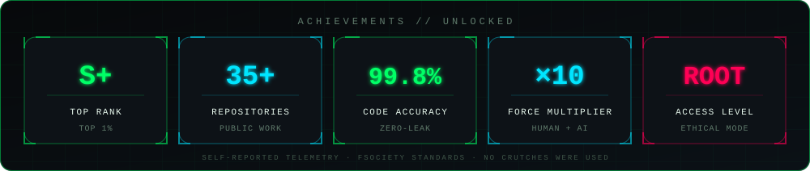

  

  
  &nbsp;
  
  &nbsp;
  
  &nbsp;
  

---

> *"What if what we see isn't the real world, but just a guess of our minds? What if we're only seeing a distorted image that we'll never fully understand?"*  
> — **Elliot Alderson [fsociety]**

---

<!--
  IMPORTANT: custom HUD widgets (telemetry / skills / achievements) live in ./widgets/*.svg
  Copy the whole "widgets" folder into your profile repo (whyudontcallme/whyudontcallme)
  so the relative paths below resolve. Everything else loads from public services.
-->

 

<h3 align="center">⚡ SYSTEM TELEMETRY &amp; OVERCLOCK STATUS ⚡</h3>

  

  
  
  
  
  

---

## 👤 Обо мне &amp; Инженерная философия

- ⚡ **Возраст:** Мне **17 лет**, Санкт-Петербург (удалённо / проектная работа / Full-time).
- 🧠 **ИИ как экзоскелет, а не костыль:**  
  Слабые программисты используют нейросети как костыль, маскирующий пробелы в базе.  
  **Для меня ИИ — это мультипликатор силы (force multiplier):**
  - **Мгновенный MVP за часы:** сборка рабочего решения со сложной логикой, пока другие только пишут спецификацию.
  - **Глубокий фундамент:** я знаю, как устроены алгоритмы, Event Loop, сокеты, заголовки и безопасность на уровне байтов, поэтому контролирую каждую строчку сгенерированного кода.
  - **Стресс-тестирование:** автогенерация десятков граничных кейсов (edge cases) и уязвимостей до релиза в прод.
- 🚀 **Практика:** 35+ публичных репозиториев, коммерческие запуски в B2B, Telegram Business системы с реальной аудиторией, WebGL 3D.
- 🛡️ **Интересы:** веб-архитектура, безопасность, Telegram Bot &amp; Business API, эвристические алгоритмы, Linux.

---

## 🛠️ Skill Matrix

  

  

### 🤖 Что мы с ИИ делаем на ура (AI-Augmented Engineering)
- ✦ **Сверхбыстрый запуск MVP:** от голой идеи до живого работающего сервиса с деплоем за один день.
- ✦ **Генерация нетривиальных edge-кейсов:** автоматический поиск уязвимостей в бизнес-логике и покрытие тестами.
- ✦ **Интеллектуальный рефакторинг:** оптимизация сложности $O(n)$, повышение читаемости и архитектурной чистоты.
- ✦ **Интеграция LLM &amp; нейросетевых API:** построение пайплайнов с OpenAI, Claude и локальными моделями.
- ✦ **Продвинутый Prompt Engineering:** системные промпты, function calling и автономные цепочки выполнения.

---

## 📊 Live GitHub Telemetry

  

  

  

<!--
  If the stats card ever stops loading, swap the host with one of these mirrors:
    https://github-readme-stats.vercel.app              (official, often rate-limited)
    https://github-readme-stats-sigma-five.vercel.app   (mirror)
-->

---

## 🏅 Unlocked Achievements

  

---

## 💻 Избранные проекты

| Проект | Описание | Стек | Ссылки |
| :--- | :--- | :--- | :--- |
| ⚪ **[Chronos](https://github.com/whyudontcallme/chronos)** | 3D визуализация потери времени и прокрастинации в реальном времени. Интерактивная сфера деформируется по мере отвлечения. | `JavaScript` `WebGL` `Canvas` `CSS3` | [🌐 Демо](https://whyudontcallme.github.io/chronos/Chronos.html) • [🐙 Репо](https://github.com/whyudontcallme/chronos) |
| 🎙️ **[Voice-Translator](https://github.com/whyudontcallme/Voice-Translator)** | Голосовой переводчик на 16 языков: распознавание голоса с микрофона, каскадный перевод (Google/MyMemory/Bing) и голосовой синтез. | `Web Speech API` `JavaScript` `REST APIs` | [🐙 Репо](https://github.com/whyudontcallme/Voice-Translator) |
| 📅 **[Schedule PWA](https://github.com/whyudontcallme/schedule)** | Мобильное PWA-расписание: автоопределение чётности недель, таймер текущей пары, офлайн-режим и экспорт в чаты. | `PWA` `JavaScript` `Offline Cache` | [🐙 Репо](https://github.com/whyudontcallme/schedule) |
| 👁️ **[All-Seeing TG Bot](https://github.com/whyudontcallme/spy-seeing-Telegram-bot)** | Бот для Telegram Business: аудит удалённых и отредактированных сообщений в личных чатах с уведомлением владельца. | `Python 3` `Telegram Business API` `DB` | [🐙 Репо](https://github.com/whyudontcallme/spy-seeing-Telegram-bot) |
| 🏭 **[IK-Sushka](https://github.com/whyudontcallme/ik-sushka)** | Коммерческий веб-портал промышленного оборудования с Vercel Serverless релеем в Telegram и калькуляторами. | `HTML5` `CSS3` `JavaScript` `Vercel API` | [🌐 Сайт](https://ik-sushka.vercel.app) • [🐙 Репо](https://github.com/whyudontcallme/ik-sushka) |
| 🌱 **[GAIA-RU](https://github.com/whyudontcallme/gayanew)** | Корпоративный сайт дистрибьютора GAIA Corp. с инженерным интерактивным калькулятором окупаемости и каталогом. | `JavaScript` `HTML5` `CSS Grid/Flex` | [🐙 Репо](https://github.com/whyudontcallme/gayanew) |
| ✨ **[MIR Club](https://github.com/whyudontcallme/mirclub)** | Веб-платформа с витриной сервисов компании, личным кабинетом и плавными CSS-анимациями. | `JavaScript` `CSS Animations` `Netlify` | [🐙 Репо](https://github.com/whyudontcallme/mirclub) |
| 🧭 **[A* Algorithm](https://github.com/whyudontcallme/astar)** | Реализация эвристического алгоритма A* (A-Star) на Python для эффективного поиска кратчайшего пути на сетках с препятствиями. | `Python 3` `Algorithms` `Graph Theory` | [🐙 Репо](https://github.com/whyudontcallme/astar) |
| ⛺ **[YanaBot](https://github.com/whyudontcallme/yanabot)** | Telegram-ассистент правовой и регламентной поддержки вожатых детских оздоровительных лагерей. | `Python` `Telegram Bot API` | [🐙 Репо](https://github.com/whyudontcallme/yanabot) |
| 🛡️ **[DeepGuard](https://github.com/whyudontcallme/deepguard)** | Инструментарий мониторинга безопасности сетевого контура и проверки открытых портов. | `Python` `Network Auditing` `Linux` | [🐙 Репо](https://github.com/whyudontcallme/deepguard) |

---

<!--
  🐍 CONTRIBUTION SNAKE — optional, enable the Action first.
  Workflow file: portfolio/github-workflows/snake.yml
  Place it at:   .github/workflows/snake.yml
  Then uncomment the block below:

  ## 🐍 Contribution Snake

  

    
  

  ---
-->

## 📬 Связаться со мной

  <b>Открыт к предложениям о работе, коммерческим проектам и стажировкам.</b> 
  Напишите напрямую в Telegram для быстрого ответа:

  
  &nbsp;&nbsp;
  

 

